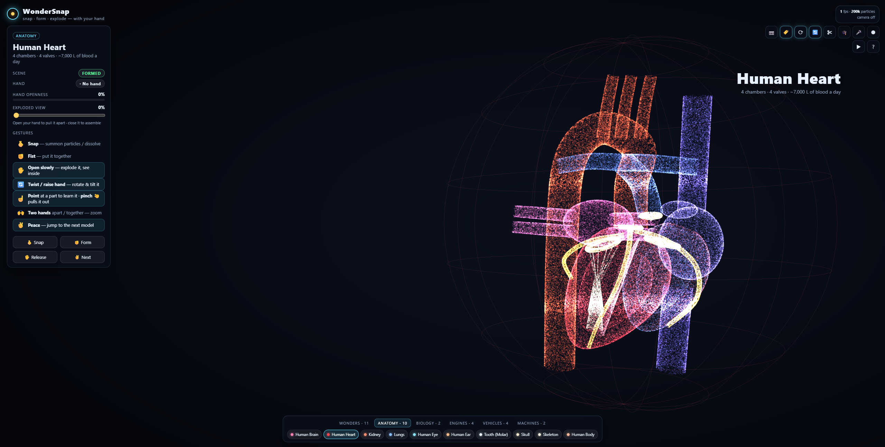

# OmniVerse

<div align="center">

  **Next-Generation Spatial 3D Particle Universe Powered by WebGL2 and MediaPipe AI**

  [](LICENSE)
  [](https://nodejs.org/)
  [](https://developer.mozilla.org/en-US/docs/Web/API/WebGL2RenderingContext)
  [](https://ai.google.dev/edge/mediapipe/solutions/vision/hand_landmarker)
  [](https://omniverse-gules.vercel.app)

  [**Explore Live Demo**](https://omniverse-gules.vercel.app) · [**Alternative Mirror**](https://omni-verse-delta.vercel.app) · [**Report Issue**](https://github.com/PRAKASH-2012/OmniVerse/issues)

</div>

---

## Executive Overview

**OmniVerse** is an interactive, spatial computing web application that brings three-dimensional models to life as dynamic systems of up to 250,000 luminous GPU particles. Built entirely on standard web technologies without external 3D engines, OmniVerse pairs custom **WebGL2 transform-feedback compute shaders** with on-device computer vision through **Google MediaPipe Hand Landmarker**. 

Users interact directly through their webcam using intuitive, touchless hand gestures: snapping fingers to summon or dissolve particle clouds, closing fists to assemble intricate structures, opening palms to trigger exploded engineering schematics, and twisting hands to orient objects in real time. The platform requires zero native installations, operates entirely client-side for complete user privacy, and supports seamless fallback to keyboard and mouse controls.



---

## Key Highlights & Innovations

- **Proprietary GPU Transform-Feedback Architecture**: By executing all particle physics, turbulence fields, and target-attraction algorithms directly on the GPU using WebGL2 transform feedback, OmniVerse maintains a smooth 60 frames per second without the memory or runtime overhead of third-party 3D frameworks.
- **Privacy-Centric, Edge Computer Vision**: Webcam video frames are processed strictly on-device using WebAssembly and WebGL delegates via Google MediaPipe Tasks Vision. Video streams never leave the client device or touch external servers.
- **High-Fidelity Procedural Modeling**: Features 33 mathematically defined 3D models spanning world wonders, human anatomy, cellular biology, combustion and jet engines, aerospace systems, and horology.
- **Dynamic Structural Exploded Views**: Mechanical assemblies and anatomical organs can be continuously pulled apart into exploded component views guided by the user's hand openness.
- **Physiological Simulations**: Anatomical models feature dynamic physiological behaviors, including a dual-phase cardiac cycle (72 bpm lub-dub contraction) and pulmonary respiration cycles with luminous particulate flows.
- **Spatial Audio & Voice Control**: Integrated speech recognition and synthesis enable voice-directed model selection, inspection queries, and narrated educational insights.
- **Interactive Educational Quizzing**: An interactive quiz mode guides students and enthusiasts through identifying specific biological and mechanical components in 3D space.

---

## Interactive Spatial Gestures

OmniVerse tracks up to 21 three-dimensional landmarks per hand in real time, translating continuous geometric relations into responsive commands.

| Gesture | Pose Icon | Action & Visual Response |
| :--- | :---: | :--- |
| **Finger Snap** | 🫰 | **Summon / Dissolve**: Instantly triggers high-velocity particle nucleation or disperses the active model into an ambient kinetic cloud. |
| **Clenched Fist** | ✊ | **Form & Consolidate**: Attracts particles inward toward target anchor coordinates, assembling the selected architectural or mechanical model. |
| **Open Palm** | ✋ | **Exploded View / Transition**: In engineering and anatomical models, palm openness proportionally expands internal sub-assemblies along radial vectors. In monuments, opening the palm advances to the next exhibit. |
| **Hand Twist & Tilt** | 🔄 | **Spatial Orientation**: Rotating your wrist turns the 3D model around its vertical axis; raising or lowering your hand adjusts camera pitch angle. |
| **Index Pointing** | ☝️ | **Component Selection**: Aiming your index fingertip at a component highlights it with an accentuated luminescence and reveals detailed informational callouts. |
| **Pinch Grip** | 🤏 | **Component Extraction**: Pinching thumb and index finger pulls the selected sub-part out toward the viewer for closer inspection. |
| **Dual-Hand Separation** | 🙌 | **Bimanual Zoom**: Moving two hands closer together or further apart dynamically scales the magnification of the scene. |
| **Peace Sign** | ✌️ | **Quick Navigation**: Showing two raised fingers immediately transitions forward to the subsequent exhibit in the catalog. |

---

## Comprehensive 3D Model Catalog

OmniVerse contains 33 mathematically synthesized 3D models, each partitioned into independently addressable, labeled, and interactive sub-components:

| Domain | Total | Featured Exhibits & Sub-Components |
| :--- | :---: | :--- |
| **World Wonders** | 11 | Turtle Tower, Eiffel Tower, Statue of Liberty, Burj Khalifa, Great Pyramid of Giza, Roman Colosseum, Leaning Tower of Pisa, Taj Mahal, Big Ben, Christ the Redeemer, and Sydney Opera House. |
| **Human Anatomy** | 10 | Detailed Cerebral Cortex, Beating Heart (with functional chambers, valves, and aorta), Respiratory Lungs with bronchial trees, Human Eye, Auditory Ear, Dental Anatomy, Cranial Skull, Skeletal System, Kidney, and Comprehensive Multi-Layer Human Body (skin, musculature, vascular, nervous, and skeletal systems). |
| **Cellular Biology** | 2 | Unzipping DNA Double Helix (with complementary base pairs), Complex Animal Cell (mitochondria, nucleus, endoplasmic reticulum, and Golgi apparatus). |
| **Mechanical Engines** | 4 | Inline-4 Internal Combustion Engine (pistons, crankshaft, connecting rods), Supercharged HEMI V8, Turbofan Jet Engine (bypass fans, compressors, combustion chambers), and 9-Cylinder Aviation Radial Engine. |
| **Vehicles & Aerospace** | 4 | Aerodynamic Sports Car, Classic Motorcycle, Commercial Passenger Airliner, and Saturn V Rocket (with multistage separation mechanics). |
| **Precision Machines** | 2 | Luxury Mechanical Wristwatch (escapement, balance wheel, gear train), and Modular EV Battery Pack (280 cylindrical cells, busbars, liquid cooling channels, and Battery Management System). |

---

## Alternate Keyboard & Mouse Controls

For environments without webcam access or for automated validation, OmniVerse provides complete keyboard and mouse fallbacks:

| Key Binding | Functionality |
| :--- | :--- |
| <kbd>Space</kbd> | Snap gesture — Summon particle cloud or dissolve active model |
| <kbd>F</kbd> / <kbd>O</kbd> | Clenched Fist (form model) / Open Palm (explode or advance) |
| <kbd>V</kbd> or <kbd>→</kbd> / <kbd>←</kbd> | Navigate to next / previous model |
| <kbd>E</kbd>, <kbd>↑</kbd> / <kbd>↓</kbd>, Mouse Wheel | Adjust exploded assembly distance |
| <kbd>+</kbd> / <kbd>-</kbd> / <kbd>0</kbd>, <kbd>Ctrl</kbd> + Wheel | Zoom camera in / out / reset |
| <kbd>C</kbd> | Toggle webcam tracking on / off |
| <kbd>L</kbd> | Toggle component HUD labels and leader lines |
| <kbd>R</kbd> | Toggle automatic turntable rotation |
| <kbd>G</kbd> | Toggle hand-driven rotational tracking |
| <kbd>X</kbd>, <kbd>,</kbd> / <kbd>.</kbd> | Enable cut-away slicing plane (nudge cross-section plane) |
| <kbd>Q</kbd> | Launch interactive 5-question anatomical / mechanical quiz |
| <kbd>M</kbd> | Toggle speech recognition and read-aloud voice narration |
| <kbd>K</kbd> | Start / stop in-browser session recording (downloads WebM video) |
| <kbd>D</kbd> | Run automated guided interactive tour |
| <kbd>I</kbd> / <kbd>Esc</kbd> | Inspect active part details / deselect component |
| <kbd>H</kbd> | Toggle interactive help overlay |
| **Left Click + Drag** | Manually rotate the 3D model in spherical coordinates |

---

## System Architecture

OmniVerse is engineered around a decoupled, modular design pipeline:

```
┌────────────────────────┐      ┌───────────────────────────┐      ┌─────────────────────────┐
│     Webcam Input       │ ───> │   MediaPipe Landmarker    │ ───> │   Gesture State Machine │
│ (1280x720 @ 30 FPS)    │      │ (21 Landmarks via WASM)   │      │ (Poses, Snap, Debounce) │
└────────────────────────┘      └───────────────────────────┘      └─────────────────────────┘
                                                                                │
                                                                                ▼
┌────────────────────────┐      ┌───────────────────────────┐      ┌─────────────────────────┐
│  Procedural Generators │ ───> │ WebGL2 Transform Feedback │ <─── │   Interactive Events    │
│  (Worker Thread Cache) │      │ (Ping-Pong GPU Simulation)│      │  (Voice, GUI, Keyboard) │
└────────────────────────┘      └───────────────────────────┘      └─────────────────────────┘
                                                │
                                                ▼
                                ┌───────────────────────────┐
                                │ Canvas Output (60 FPS)    │
                                │  + Canvas 2D HUD Overlay  │
                                └───────────────────────────┘
```

1. **Vision Ingestion Layer** (`src/hands.js`): Interfaces with the user's webcam via `navigator.mediaDevices.getUserMedia` and processes frames through MediaPipe Vision Tasks. Includes automatic fallback to public CDN bundles when running on static deployments.
2. **Gesture Recognition Layer** (`src/logic/gestures.js`, `src/logic/controller.js`): Performs continuous vector mathematics on joint landmarks, determining static poses, dynamic snap velocities, hand pitch, and angular twist.
3. **Procedural Geometry Engine** (`src/lib/`, `src/models/`, `src/worker.js`): Generates point coordinates and surface normals based on actual physical measurements, transferred to the GPU via an asynchronous Web Worker to prevent main-thread frame drops.
4. **GPU Simulation Pipeline** (`src/gl/`): Manages double-buffered transform-feedback vertex shaders, calculating instantaneous particle velocities, turbulence vectors, and explosion offsets directly within GPU memory.
5. **UI & Audio Narration** (`src/features.js`): Manages the glassmorphism HUD, speech recognition commands, Web Speech API vocalizations, and high-definition video recording via `MediaRecorder`.

---

## Getting Started

### Prerequisites

- **Node.js**: Version 18.0.0 or higher ([Download Node.js](https://nodejs.org/))
- **Web Browser**: A modern browser supporting WebGL2 and Camera API (Google Chrome, Microsoft Edge, or Mozilla Firefox recommended)

### Local Installation & Setup

1. **Clone the repository:**
   ```bash
   git clone https://github.com/PRAKASH-2012/OmniVerse.git
   cd OmniVerse
   ```

2. **Install dependencies:**
   ```bash
   npm install
   ```

3. **Launch the local development server:**
   ```bash
   npm start
   ```

4. **Open in browser:**
   Navigate to **[http://localhost:5173](http://localhost:5173)**. Click **Start with camera** to enable hand-tracking, or select **Continue without camera** to control the application via mouse and keyboard.

---

## URL Parameters & Customization

Fine-tune performance and behavior directly through URL query flags:

| Query Parameter | Example Value | Description |
| :--- | :--- | :--- |
| `n` | `?n=200000` | Sets particle density (supported range: 5,000 to 1,000,000 particles). |
| `model` | `?model=1` | Specifies initial model index on startup (0 = Turtle Tower, 1 = Eiffel Tower, etc.). |
| `autostart` | `?autostart=camera` | Bypasses the start modal and immediately requests camera access (`camera` or `nocamera`). |
| `trails` | `?trails=0` | Disables velocity motion blur and particle trails for higher performance on integrated GPUs. |
| `dpr` | `?dpr=1` | Overrides the target device pixel ratio (useful for high-resolution 4K/retina displays). |

---

## Testing & Quality Assurance

OmniVerse includes a comprehensive test suite of 39 end-to-end specifications powered by [Playwright](https://playwright.dev/). The tests run the live application against synthetic hands on a deterministic simulated clock to ensure mathematical and visual accuracy:

```bash
# Install Chromium browser binaries
npx playwright install chromium

# Execute the complete automated test suite
npm test

# View interactive HTML test reports
npm run test:report
```

---

## Deployment

### Deploying to Vercel
OmniVerse is fully configured for zero-config static hosting on Vercel:
```bash
# Production build and deployment
npm run build
npx vercel --prod
```
The application builds static assets into `dist/` and runs on Vercel's global Edge Network.

### Deploying to GitHub Pages
The repository includes an automated workflow (`.github/workflows/deploy.yml`). To enable:
1. Navigate to your repository **Settings > Pages**.
2. Under **Build and deployment > Source**, choose **GitHub Actions**.
3. Push to the `main` branch to trigger automated deployment.

---

## Privacy & Security

OmniVerse is engineered with a strict privacy-first architecture:
- All computer vision inferences are executed locally in browser memory using WebAssembly and WebGL.
- Video streams from your camera are never recorded, cached, or transmitted over network connections.
- The project operates entirely without telemetry or external tracking scripts.

---

## License

This project is licensed under the [MIT License](LICENSE) — free for educational, personal, and commercial usage.
